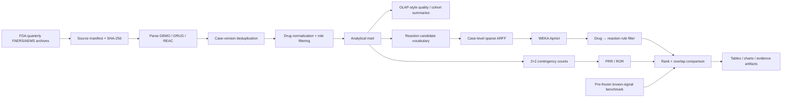
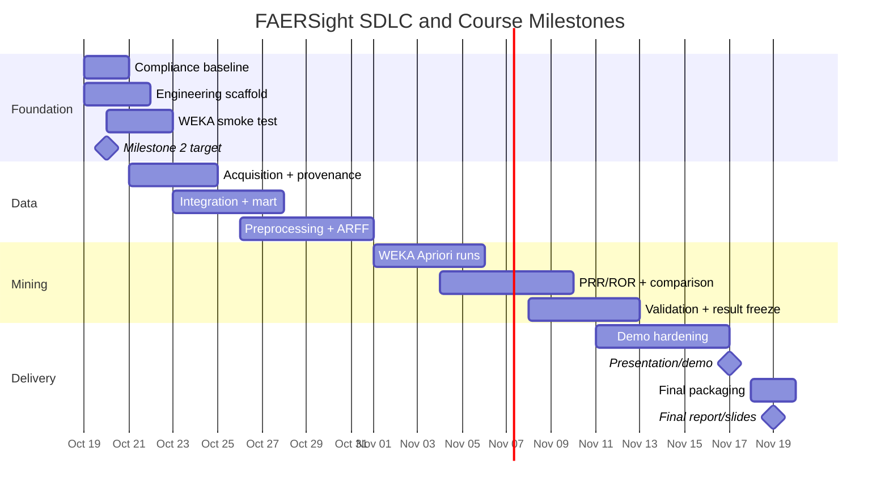

# FAERSight — Drug Safety Signal Discovery Through Data Mining

**Repository document:** `PRD.md`  
**Course:** ECE 537 / CIS 568 — Data Mining, Fall 2026  
**Project type:** Individual application-oriented data-mining project  
**Primary mining tool:** **WEKA Apriori — mandatory**  
**Supporting implementation:** Python for acquisition, preprocessing, validation, statistics, testing, and reproducibility  
**Primary dataset:** FDA FAERS/AEMS quarterly adverse-event extracts — `DEMO`, `DRUG`, and `REAC`  
**Scope:** One therapeutic drug class, one or two quarterly extracts  
**Status:** Implementation-ready draft  
**Academic-use boundary:** This PRD is an engineering/planning artifact. Generative AI must **not** write submitted course reports, literature-review prose, slides, presentation narration, quizzes, or exams.

## Executive Summary

FAERSight is an end-to-end data-mining project for discovering and evaluating drug–adverse-reaction reporting signals in FDA spontaneous adverse-event data. The project will ingest one or two official quarterly FAERS/AEMS extracts, integrate the `DEMO`, `DRUG`, and `REAC` relations, clean and deduplicate case reports, normalize drugs in one selected therapeutic class, construct a case-level transactional representation, and use **WEKA's Apriori implementation** to mine association rules of the form:

\[
\text{DRUG}_{x} \rightarrow \text{REAC}_{y}
\]

The project then independently computes the pharmacovigilance disproportionality measures **Proportional Reporting Ratio (PRR)** and **Reporting Odds Ratio (ROR)** for the same candidate drug–reaction pairs. Rather than treating Apriori and disproportionality analysis as unrelated competitors, the central analytical question is **when their rankings agree, when they differ, and whether disagreements can be explained by denominator choice, sparse report counts, mining thresholds, or report composition**. This framing follows the strongest conclusion of the prior literature research and is methodologically stronger than merely demonstrating that Apriori can be run on FAERS. fileciteturn0file7 fileciteturn0file8

This architecture mirrors the course's Knowledge Discovery in Databases process: raw databases are cleaned and integrated, task-relevant data are selected, mining discovers patterns, and those patterns are subsequently evaluated and presented. fileciteturn0file1 It maps especially directly to Lecture 03's integrated, analytical view of data; Lecture 04's cleaning, integration, transformation, and reduction stages; and Lecture 05's five mining primitives—task-relevant data, kind of knowledge, background knowledge, interestingness measures, and presentation. fileciteturn0file3 fileciteturn0file4 fileciteturn0file5

The project intentionally does **not** attempt causal inference. FDA warns that an adverse-event report can contain several drugs and several reactions without linking a particular drug to a particular reaction, that spontaneous reports are not extensively verified, and that report counts cannot establish incidence or causality. Accordingly, FAERSight will use terms such as **reporting association**, **signal**, and **disproportionate reporting**, not claims that a drug causes a reaction or changes clinical risk by a particular amount. citeturn7search7

Although the FDA moved FAERS data into the broader Adverse Event Monitoring System (AEMS) on March 11, 2026, the FDA continues to publish the familiar non-cumulative quarterly extracts, including demographic/administrative, drug, reaction, outcome, and source files. FAERSight will retain its approved/project-recognizable name while documenting the current AEMS nomenclature in data provenance metadata. citeturn7search0turn7search1

### Success definition

FAERSight is successful when it can reproducibly demonstrate the complete path:

**official FDA data → integrated analytical data → cleaned case-level transactions → WEKA Apriori rules → independently calculated PRR/ROR → quantified comparison → defensible findings**

The resume-quality target is deliberately bounded. The project does **not** need multi-year temporal surveillance, a web application, deep learning, Bayesian pharmacovigilance algorithms, or a production data warehouse. Its value comes from using messy public biomedical data correctly, applying course methods visibly, validating statistical calculations, and producing reproducible experimental evidence.



## Product Definition and Course Alignment

### Research question and objectives

The primary research question is:

> **For one therapeutic drug class over one or two FDA reporting quarters, how do drug–reaction associations mined with WEKA Apriori using support, confidence, and lift compare with PRR and ROR calculated from the same deduplicated report universe? In particular, which pairs remain highly ranked across methods, which pairs change rank, and can disagreements be explained by denominator choice, sparse counts, mining thresholds, or suspect-drug definitions?**

This is analytically meaningful because lift and PRR share the drug-conditional reaction frequency in their numerator but use different background quantities in their denominators. Consequently, substantial agreement is mathematically plausible, while deviations can expose the effect of background definition and report composition. Evans et al. formalized PRR as a comparison of the reaction proportion for a target drug with that among other drugs, while Wang et al. demonstrated that association-rule mining can perform competitively as a spontaneous-report signal-generation approach. citeturn7search16turn9search2

The project objectives are to:

1. transform raw relational FDA safety data into a traceable analytical representation;
2. demonstrate course concepts from data warehousing, preprocessing, and data-mining primitives through actual implementation;
3. use **WEKA Apriori**, rather than a Python replacement, for the scored association-rule experiment;
4. independently implement and verify PRR/ROR;
5. compare ranking behavior rather than merely show isolated "interesting" rules;
6. establish enough software and experiment rigor to make the project credible on an AI/ML or data-science resume;
7. stop once the bounded course-and-resume target is met rather than expanding into a pharmacovigilance research thesis.

### Course compliance matrix

The course describes the term project as hands-on work with real-world data using a data-mining software tool; the curriculum explicitly includes data exploration/preprocessing, OLAP/data warehousing, and association analysis. fileciteturn0file0 The uploaded Milestone 2 template additionally requires at least four journal/conference references, citation of every listed reference, and explicitly prohibits generative-AI-written submission text. fileciteturn0file9

The agent should update the final column only when concrete evidence exists.

| Course/project requirement | FAERSight implementation | Evidence required | Agent complete |
|---|---|---|---|
| Real-world dataset | Official FDA FAERS/AEMS quarterly data | Frozen source manifest and checksums | [ ] |
| Use a data-mining software tool | **WEKA Apriori** performs the association-rule mining | WEKA version, settings, raw output, screenshot/log | [ ] |
| Application-oriented data-mining study | Drug-safety reporting-signal detection | Approved scope + working experiment | [ ] |
| Biomedical data-mining relevance | FDA post-marketing safety reports | Dataset/method description | [ ] |
| `DEMO` data used | Case/version and administrative metadata for case-level integration/deduplication | Parsed `DEMO` audit | [ ] |
| `DRUG` data used | Drug names, role codes, target-class exposure | Parsed `DRUG` audit | [ ] |
| `REAC` data used | Standardized reported reactions | Parsed `REAC` audit | [ ] |
| One therapeutic class | Candidate antecedent drugs restricted to one frozen class | `therapeutic_class.yaml` | [ ] |
| One or two quarters | Experiment config freezes one or two FDA quarterly extracts | `experiment.yaml` | [ ] |
| Data warehousing / OLAP concepts | Integrated analytical mart and slice/dice summaries by quarter, drug, role, reaction | Summary tables/query outputs | [ ] |
| Data preprocessing concepts | Cleaning, deduplication, integration, normalization, transformation and reduction documented | `preprocess_audit.json` | [ ] |
| Mining primitives | All five Lecture 05 primitives explicitly instantiated | PRD/config/evidence table | [ ] |
| Association-rule mining | Drug-presence → reaction-presence rules | WEKA raw output + parsed rules | [ ] |
| Pattern interestingness | Support, confidence, lift plus PRR/ROR comparison | `signals.csv` / comparison tables | [ ] |
| Literature review | Minimum four journal/conference papers; every listed source cited | **Student-written** Milestone 2 submission | [ ] |
| Literature/progress milestone | Plan against **October 20, 2026**, the date printed on the supplied milestone template | Canvas submission confirmation | [ ] |
| Final presentation/demo | Working reproducible workflow demonstrated | Demo checklist / student slides | [ ] |
| Final presentation date | November 17, 2026 | Submission/presentation evidence | [ ] |
| Final report/slides | Course-format final artifacts | Canvas submission confirmation | [ ] |
| Final upload date | November 19, 2026, 11:59 p.m. | Canvas submission confirmation | [ ] |
| No GenAI-written graded prose | Student authors all submitted report/slide/narration prose | Student attestation | [ ] |
| Results evaluated, not merely generated | Agreement/disagreement and limitations analyzed | Generated evidence + student interpretation | [ ] |
| Reproducibility | Clean-environment rerun regenerates key artifacts | Reproduction log + artifact hashes | [ ] |

There is an internal date inconsistency in the supplied course materials: one syllabus milestone table shows the literature/progress milestone later in October, while the dedicated Milestone 2 template states **Tuesday, October 20**. The project should plan against the earlier October 20 deadline and treat Canvas as the ultimate authority rather than risking a late submission. fileciteturn0file0 fileciteturn0file9

### Course-topic mapping to the SDLC

| SDLC activity | Course concept | How FAERSight demonstrates it |
|---|---|---|
| Requirements / analysis | KDD application-domain understanding | Define safety-signal question, population and limitations |
| Data acquisition | Task-relevant data | Freeze quarter(s), tables and therapeutic class |
| Data design | Lecture 03 data warehousing | Integrate source relations into a read-oriented analytical mart |
| Data validation | Lecture 03 integrated/nonvolatile data | Freeze inputs; reconcile schemas; preserve provenance |
| Preprocessing | Lecture 04 data cleaning | Missing-value policy, duplicate/version handling, malformed rows |
| Preprocessing | Lecture 04 data integration | Join `DEMO`, `DRUG`, `REAC` at case/report level |
| Transformation | Lecture 04 transformation/reduction | Normalize class drugs; select relevant reaction vocabulary; create binary transaction features |
| Mining design | Lecture 05 primitive: task-relevant data | Explicit minable view |
| Mining implementation | Lecture 05 primitive: knowledge type | Association-rule mining |
| Domain semantics | Lecture 05 primitive: background knowledge | Drug class, active ingredients, drug-role codes, known safety information |
| Evaluation | Lecture 05 primitive: interestingness | Support, confidence, lift, PRR, ROR, count stability |
| Presentation | Lecture 05 primitive: visualization | Rules, cross-tabs, ranked comparisons and concise charts |
| Verification | KDD pattern evaluation | Known-signal recovery, threshold sensitivity, manual audits |

Lecture 03 defines analytical warehousing around integrated, subject-oriented and historical data and introduces multidimensional analysis through dimensions, measures, slice/dice and aggregation. FAERSight will apply those ideas through a **small analytical mart**, not by building an unnecessary enterprise warehouse. fileciteturn0file3 Lecture 04 makes cleaning, integration, transformation and reduction central to data quality; those steps map directly to FAERS case deduplication, drug normalization, relation joins and transaction construction. fileciteturn0file4 Lecture 05's five primitives will serve as the formal specification of the actual mining task rather than as terminology added after implementation. fileciteturn0file5

### Decisions to confirm

These decisions intentionally remain unresolved until evidence is collected.

| Decision | Selection criteria | Blocking point |
|---|---|---|
| Therapeutic class | Manageable number of active ingredients; adequate report volume; documented known reactions; normalization feasible | Before full preprocessing |
| Quarter | Complete official extract, stable schema, adequate volume | Before real-data download |
| Second quarter | Add only if useful and schedule permits | After first-quarter pipeline succeeds |
| WEKA version | Exact stable version installed and smoke-tested; version pinned in manifest | Before WEKA smoke test |
| Drug-role primary definition | Proposed: primary suspect (`PS`) for primary analysis | Before final transactions |
| Role sensitivity | Proposed: `PS+SS` as one limited sensitivity experiment | Before final analysis |
| Reaction-vocabulary floor | Predefined absolute support/candidate-count rule, justified before result inspection | Before ARFF generation |
| Known-signal benchmark | Approximately 5–10 externally documented positive pairs selected before final ranking | Before full WEKA experiment |
| Threshold grid | Small predefined support/metric sweep, not tuned until attractive results appear | Before final WEKA experiment |

The FDA currently publishes 2026 quarterly ASCII and XML archives and describes them as raw, non-cumulative extracts; therefore Codex can automate their retrieval once the quarter is frozen rather than requiring the student to download them manually. citeturn7search0turn7search4

### Explicit non-goals

The core project will **not** build a full enterprise data warehouse, implement Apriori from scratch, replace WEKA with `mlxtend`, train neural networks, run a multi-year longitudinal study, build a web dashboard, perform drug–drug-interaction discovery, estimate clinical incidence, make causal safety claims, or implement additional pharmacovigilance algorithms such as EBGM/BCPNN merely to increase algorithm count.

Those additions would increase effort without materially improving course alignment. The literature already shows that FAERS cleaning choices can materially alter downstream results, making a carefully validated smaller experiment preferable to an oversized analysis. citeturn9search5

## System Architecture and Data Contract

### Source-data contract

The official quarterly archive is the source of truth. FDA states that the quarterly files are raw and non-cumulative and include demographic/administrative, drug and reaction information among their component files. citeturn7search0turn7search4 The project will use only:

| File | Required fields/concepts | Project role |
|---|---|---|
| `DEMO` | Case/report identifiers, case version, quarter/admin metadata | Deduplication and case universe |
| `DRUG` | Case/report identifier, drug sequence, drug role, drug name | Exposure construction and active-ingredient mapping |
| `REAC` | Case/report identifier, reaction sequence/term | Reaction-presence construction |

The FDA/openFDA data model includes report identifiers and version fields, and later submissions may update an underlying safety report; therefore case/version treatment must be deterministic and audited rather than counting every row as an independent patient event. citeturn10search2turn7search7

### Analytical data model

The project should implement a lightweight local analytical mart, preferably in **DuckDB + Parquet** or an equivalently reproducible local format. This is not required because DuckDB is a course tool; it is chosen because it makes relation integration, aggregate checks and repeatable analytical queries straightforward.

Proposed logical tables:

| Table | Grain | Important fields |
|---|---|---|
| `cases` | One retained case/version | `case_id`, `primary_id`, `case_version`, `quarter` |
| `case_drugs` | One retained case × drug record | identifiers, `role_code`, `raw_name`, `canonical_ingredient`, `target_class` |
| `case_reactions` | One retained case × reaction | identifiers, standardized reaction term |
| `case_items` | One retained case × mining item | `case_id`, `item_type`, `item_value` |
| `signal_counts` | One target drug × reaction | `a`, `b`, `c`, `d`, `N` |
| `rule_metrics` | One WEKA drug→reaction rule | support, confidence, lift, WEKA rank/config |
| `comparison` | One target drug × reaction | WEKA metrics + PRR + ROR + benchmark flag |

The analytical dimensions are **quarter, target drug, drug role and reaction**, while the core additive measure is **report count**. Simple groupings such as report counts by quarter/drug or quarter/reaction provide the OLAP-style roll-up, slice and dice evidence expected from Lecture 03 without manufacturing an unrelated warehouse subsystem. fileciteturn0file3

### Case and exposure semantics

The fundamental observation is one **deduplicated FDA case/report**. Within each retained case:

- repeated occurrences of the same normalized target drug count once for presence;
- repeated occurrences of the same reaction term count once for presence;
- the primary target-drug definition should initially use the frozen role policy;
- no one-to-one causal attribution is inferred between listed drugs and listed reactions.

This last constraint is fundamental: FDA states that reports can list multiple drugs and reactions but do not connect individual products to individual reactions. citeturn7search7

### Common analytic universe

The primary Apriori and PRR/ROR comparisons must be based on the **same eligible deduplicated report universe**. The therapeutic class limits the **candidate drug antecedents**, not necessarily the background reports.

A practical design is:

1. retain all eligible deduplicated reports in the chosen quarter(s);
2. identify target-class drug presence under the frozen role definition;
3. derive a manageable reaction vocabulary from reactions observed with the target-class drugs under a predefined support rule;
4. encode those target drugs and candidate reactions across the complete eligible report universe;
5. run WEKA Apriori;
6. retain only rules matching `DRUG_* → REAC_*`;
7. construct PRR/ROR tables from the exact same eligible report universe.

This prevents an apparent method disagreement from being caused merely by calculating lift on one population and PRR on a different population. The literature review identified this as one of the highest-priority methodological safeguards. fileciteturn0file7

### Transaction encoding and WEKA contract

The earlier atomic `(drug,reaction)` basket idea must **not** be used. A transaction must contain separate presence items, for example:

```text
CASE_123:
  DRUG_atorvastatin = 1
  REAC_myalgia      = 1
  REAC_headache     = 1
```

The WEKA export will represent each item as a nominal binary attribute `{0,1}`, with `0` declared first and `1` representing presence. Sparse ARFF is preferred for memory efficiency.

This needs special care because WEKA sparse instances omit zero-valued attributes rather than treating them as unknown, while WEKA's Apriori option `-Z` explicitly treats the first nominal/zero value as missing for mining. citeturn8search0turn8search5 A synthetic smoke test must therefore prove that WEKA discovers **presence-to-presence** rules and does not emit rules based on absence. WEKA can rank Apriori rules by confidence, lift, leverage or conviction and exposes lower/upper support controls; FAERSight's primary ranking metric will be lift while still reporting support and confidence. citeturn8search0turn8search2

### Signal statistics

For a target drug \(D\) and reaction \(R\), define:

| | Reaction present | Reaction absent |
|---|---:|---:|
| Drug present | \(a\) | \(b\) |
| Drug absent | \(c\) | \(d\) |

with:

\[
N=a+b+c+d
\]

\[
Support(D\rightarrow R)=\frac{a}{N}
\]

\[
Confidence(D\rightarrow R)=\frac{a}{a+b}
\]

\[
Lift(D\rightarrow R)=
\frac{a/(a+b)}
     {(a+c)/N}
\]

\[
PRR(D,R)=
\frac{a/(a+b)}
     {c/(c+d)}
\]

\[
ROR(D,R)=
\frac{a/b}
     {c/d}
=\frac{ad}{bc}
\]

Evans et al. established PRR as a spontaneous-report signal-generation statistic, while Rothman et al. described ROR and emphasized the epidemiologic importance of the comparison set. citeturn7search16turn7search14 Comparative work found different disproportionality measures become much more concordant as case counts increase, which is why FAERSight will always retain raw `a,b,c,d` counts and flag very sparse results rather than presenting ratios in isolation. citeturn9search1

No silent continuity correction will be applied to zero-cell tables in the primary analysis. Undefined or infinite scores should be explicitly flagged. Any later correction must be documented as a separate sensitivity analysis rather than changing the primary statistic after results are known.

### Research benchmark

Approximately **5–10 known drug–reaction pairs** should be frozen before the final experiment, using strong external evidence such as FDA labeling or established literature relevant to the chosen therapeutic class. The benchmark is for **known-signal recovery/ranking**, not a claim of formal sensitivity or specificity.

Harpaz et al. constructed a time-indexed ADR reference standard from FDA labeling revisions specifically because signal-detection algorithms require external benchmarks rather than self-validating against their own highest scores. citeturn10search4 For this smaller course project, a pre-frozen positive set captures most of that methodological benefit without adding the complexity of designing defensible negative controls.

## Requirements and Acceptance Tests

### Functional requirements

| ID | Requirement | Acceptance criterion | Priority | Complete |
|---|---|---|---|---|
| FR-DATA-01 | Acquire official quarterly data automatically | Selected archive downloads from FDA and SHA-256 is recorded | Must | [ ] |
| FR-DATA-02 | Parse `DEMO`, `DRUG`, `REAC` | All three required files load with documented row/schema counts | Must | [ ] |
| FR-DATA-03 | Freeze quarter scope | Config contains exactly 1–2 quarters | Must | [ ] |
| FR-DATA-04 | Deduplicate case versions | Exactly one retained latest eligible version per case under documented rule | Must | [ ] |
| FR-DATA-05 | Normalize target-class drugs | Every included target drug maps to a canonical active ingredient through version-controlled mapping | Must | [ ] |
| FR-DATA-06 | Preserve unmapped values | Unmapped target-relevant strings are logged, never guessed silently | Must | [ ] |
| FR-DATA-07 | Apply drug-role definition | Primary cohort follows frozen role config; counts by role are auditable | Must | [ ] |
| FR-OLAP-01 | Build analytical mart | Cases, drugs and reactions can be queried reproducibly | Must | [ ] |
| FR-OLAP-02 | Produce multidimensional summaries | Generated counts support at least quarter×drug and quarter×reaction slices | Should | [ ] |
| FR-TXN-01 | Construct one transaction per case | Transaction IDs exactly match the eligible case universe | Must | [ ] |
| FR-TXN-02 | Separate item namespaces | No combined `(drug,reaction)` atomic items exist | Must | [ ] |
| FR-TXN-03 | Produce valid sparse ARFF | WEKA parses exported file successfully | Must | [ ] |
| FR-WEKA-01 | Use WEKA Apriori | Actual scored rule mining is executed by WEKA, not Python Apriori | Must | [ ] |
| FR-WEKA-02 | Verify absence handling | Synthetic test produces presence rules and no zero/absence rule artifacts | Must | [ ] |
| FR-WEKA-03 | Persist WEKA configuration | Version and all Apriori settings saved with results | Must | [ ] |
| FR-WEKA-04 | Threshold sensitivity | Small predefined support/metric grid is run and rule counts retained | Must | [ ] |
| FR-WEKA-05 | Filter intended rule form | Final rule table contains only one target drug antecedent → one reaction consequent | Must | [ ] |
| FR-PV-01 | Compute contingency tables | Every pair preserves integer `a,b,c,d,N` | Must | [ ] |
| FR-PV-02 | Compute PRR | Formula validated against hand-calculated fixture | Must | [ ] |
| FR-PV-03 | Compute ROR | Formula validated against hand-calculated fixture | Must | [ ] |
| FR-PV-04 | Enforce common universe | For every scored pair, `a+b+c+d == N` and N equals the frozen eligible case universe | Must | [ ] |
| FR-EVAL-01 | Merge WEKA and PV results | One comparison row per eligible drug–reaction pair | Must | [ ] |
| FR-EVAL-02 | Quantify agreement | Report top-K overlap and rank correlation where mathematically defined | Should | [ ] |
| FR-EVAL-03 | Known-signal recovery | Pre-frozen benchmark pairs receive rank/recovery results | Should | [ ] |
| FR-EVAL-04 | Explain disagreements | Generated diagnostic columns expose count, denominator and role effects; interpretation remains student-written | Must | [ ] |
| FR-REP-01 | Produce experiment manifest | Commit, config, source hashes, environment and artifact hashes captured | Must | [ ] |
| FR-REP-02 | Regenerate figures/tables | Generated results require no manual spreadsheet edits | Should | [ ] |

Wang et al. found association-rule mining competitive with established spontaneous-report screening methods in their experiment, but also identified threshold selection and redundant rules as limitations; consequently FAERSight should perform a small predefined sensitivity sweep rather than copying Wang et al.'s particular support/lift settings as universal constants. citeturn9search2

### Nonfunctional requirements

| ID | Requirement | Acceptance criterion |
|---|---|---|
| NFR-01 | Reproducibility | Clean clone + frozen inputs/config regenerates all core analytical artifacts |
| NFR-02 | Traceability | Every reported metric can be traced to source hashes, code commit and experiment config |
| NFR-03 | Determinism | Fixture and preprocessing outputs have stable regression hashes when inputs/config do not change |
| NFR-04 | Correctness | Unit/integration tests pass; manual source spot-checks recorded |
| NFR-05 | Interpretability | Every reported score includes definitions and supporting report counts |
| NFR-06 | Scope control | Only one therapeutic class and at most two quarters enter core experiment |
| NFR-07 | Portability | Python workflow runs from documented environment; WEKA/Java versions pinned |
| NFR-08 | Runtime practicality | Full dataset fits available local memory/runtime or is processed in streaming/columnar form before ARFF export |
| NFR-09 | Security | Secrets never committed; public-data pipeline performs no identity enrichment/deanonymization |
| NFR-10 | Academic integrity | No generated submission prose is emitted by repository automation |
| NFR-11 | Responsible interpretation | Output terminology never labels statistical reporting associations as proven causal ADRs |
| NFR-12 | Auditability | Exclusion, normalization and dedup counts are persisted rather than only printed |

FDA specifically cautions that spontaneous reports do not establish causality and cannot be used to estimate event incidence, so NFR-11 is a scientific correctness requirement rather than merely wording preference. citeturn7search7

### Test plan

| Test ID | Level | Test | Expected result |
|---|---|---|---|
| UT-ID-01 | Unit | Same synthetic `case_id` has versions 1, 2, 3 | Only version 3 survives |
| UT-ID-02 | Unit | Duplicate case appears across two quarter fixtures | Latest eligible case version survives once |
| UT-NORM-01 | Unit | Known raw brand/generic aliases | All map to expected canonical ingredient |
| UT-NORM-02 | Unit | Unknown drug spelling | Logged as unmapped; never auto-invented |
| UT-ROLE-01 | Unit | PS, SS and concomitant records | Primary cohort obeys configured role policy |
| UT-REAC-01 | Unit | Duplicate reaction within case | Reaction presence counted once |
| UT-TXN-01 | Unit | Synthetic case with drug + two reactions | One transaction contains three separate presence items |
| UT-TXN-02 | Unit | Case lacking target drug | Remains in background if eligible, without false drug presence |
| UT-PV-01 | Unit | Hand-constructed `a,b,c,d` | Support, confidence, lift, PRR and ROR equal independent manual values within tolerance |
| UT-PV-02 | Unit | Zero-cell table | Defined sparse-value policy invoked; no silent divide-by-zero |
| INT-JOIN-01 | Integration | Join fixture `DEMO→DRUG→REAC` | No records cross case boundaries |
| INT-UNIVERSE-01 | Integration | Generate all 2×2 tables | `a+b+c+d=N` for every pair |
| INT-ARFF-01 | Integration | Export synthetic ARFF | `weka.core.Instances` parses file without error |
| INT-WEKA-01 | Integration | Hand-built toy association | WEKA produces `DRUG_A=1 → REAC_X=1` |
| INT-WEKA-02 | Integration | Same toy data with many zeros | No absence-based `=0` rule enters accepted results |
| INT-WEKA-03 | Integration | Parse WEKA output | Extracted support/confidence/lift match raw WEKA output |
| INT-COMP-01 | Integration | Join WEKA and PRR/ROR fixture | Pair identities and counts remain unchanged |
| REG-PREP-01 | Regression | Run fixture preprocessing twice | Output hash identical |
| REG-STATS-01 | Regression | Frozen fixture statistics | Golden CSV unchanged unless intentionally approved |
| REG-WEKA-01 | Regression | Frozen toy ARFF + pinned WEKA | Accepted rules remain stable |
| E2E-SMOKE-01 | End-to-end | Tiny synthetic pipeline | Raw fixture → ARFF → WEKA → PRR/ROR → comparison succeeds |
| E2E-SAMPLE-01 | End-to-end | Small real-data sample | Pipeline completes and audit invariants pass before full run |
| MAN-SOURCE-01 | Manual verification | Inspect 10–15 retained cases against source rows | Drug/reaction memberships and retained versions agree |
| MAN-RULE-01 | Manual verification | Inspect top rules | No malformed direction, absence item or obvious normalization artifact |
| MAN-REPRO-01 | Manual verification | Fresh-clone reproduction | Key summary artifact hashes match reference run |

Weka itself recommends using `weka.core.Instances` to diagnose whether an ARFF file loads correctly, so that parser check should be part of the automated smoke path rather than relying only on successful GUI import. citeturn8search4

### Acceptance gates

**Course-complete gate**

All `Must` requirements pass; WEKA has genuinely mined the rules; the final dataset uses official FDA data; course evidence exists; and the student can independently explain every preprocessing decision and metric.

**Resume-ready gate**

In addition to course completion, the repository has a reproducible README, generated pipeline diagram, quantitative dataset scale, test count, final rule count, comparison metrics, at least one meaningful agreement/disagreement finding, and preferably a small pre-frozen known-signal recovery result.

**Stop gate**

Once resume-ready acceptance is reached, do **not** automatically add more years of FAERS data, a dashboard, more signal algorithms, deep learning, or a production service. Such work requires a new explicit decision based on unusually interesting findings.

## SDLC Phase Plan and Timeline

The student is the **accountable owner of every phase**. An implementation agent may assist with code, tests, configuration and factual engineering documentation where course rules permit, but it must not author graded course prose. CI is an automated verifier, not an academic author.

### Phase plan

| Phase | Window | Owner | Core tasks | Deliverables | Exit criteria |
|---|---|---|---|---|---|
| Compliance and requirements baseline | Oct 19–20 | Student | Freeze this PRD; verify Canvas deadlines/policies; record unresolved decisions; ensure no AI-generated submission text | `PRD.md`, decision log, course checklist | Project scope and integrity boundary explicit |
| Engineering scaffold | Oct 19–21 | Student + coding agent where permitted | Python package, configs, test layout, CI, Java/WEKA environment probe | Repo skeleton, passing fixture tests | CI green; no real-data dependency required |
| WEKA proof-of-validity | Oct 20–22 | Student + coding agent | Create synthetic nominal ARFF; validate parser; run Apriori; verify `-Z`; parse output | `toy_presence.arff`, raw WEKA log, test | Presence→presence rule recovered; no absence artifacts |
| Data acquisition and provenance | Oct 21–24 | Student + coding agent | Choose class/quarter; download archive; checksum; extract DEMO/DRUG/REAC; schema/row audits | `data_manifest.json`, download script, audit | Source frozen and reproducible |
| Data integration and analytical mart | Oct 23–27 | Student + coding agent | Parse, harmonize, deduplicate; load mart; OLAP-style summaries | Parquet/DuckDB outputs, audit JSON | Case/version invariants pass |
| Preprocessing and transaction engineering | Oct 26–31 | Student + coding agent | Freeze class mapping; role policy; reaction vocabulary; export sparse ARFF | mappings, ARFF, preprocess audit | Manual source audit passes; WEKA accepts real ARFF |
| Apriori experiment | Nov 1–5 | Student + coding agent | Run predefined threshold grid; persist configs/raw output; filter drug→reaction rules | `weka_runs/`, `rules.csv` | Rule outputs reproducible and interpretable |
| PRR/ROR and comparison | Nov 4–9 | Student + coding agent | Generate 2×2 tables; calculate scores; merge rankings; agreement metrics | `signal_counts.csv`, `comparison.csv` | Unit tests and common-universe invariants pass |
| Validation and result freeze | Nov 8–12 | Student | Run known-signal benchmark; limited role sensitivity; freeze final experiment | benchmark results, final manifest | Core findings stable and artifacts hashed |
| Demo hardening | Nov 11–16 | Student | Fresh-clone rehearsal; prepare generated figures; rehearse WEKA demonstration | demo evidence, reproducibility log | Full demo works without ad hoc repair |
| Course presentation | Nov 17 | **Student only for submitted/presented content** | Present and demonstrate | Student-authored slides/demo | Completed |
| Final packaging | Nov 18–19 | **Student only for submitted prose** | Write report personally; verify page/template/file rules; attach programs if required | Final report/slides/code | Upload before course deadline |



### Phase-level detail

#### Requirements and compliance baseline

The agent may begin implementation immediately without waiting for class or quarter selection. It should scaffold interfaces around unresolved configuration values rather than hard-code guesses.

Required outputs:

```text
config/
  experiment.example.yaml
  therapeutic_class.example.yaml
docs/
  decisions.md
  course_compliance.md
```

The phase exits only when `course_compliance.md` distinguishes **course-mandatory**, **methodologically recommended**, and **portfolio-target** work so later scope creep cannot masquerade as a requirement.

#### Engineering scaffold and WEKA smoke test

WEKA should appear **early as a validity test**, even though the real WEKA experiment comes later. This prevents the project from building an entire preprocessing stack around an invalid representation.

Suggested bootstrap commands:

```bash
python -m venv .venv
source .venv/bin/activate
python -m pip install --upgrade pip
pip install -e ".[dev]"

python -m pytest -q
python -m faersight.cli validate-config config/experiment.example.yaml

java -version
java -cp "$WEKA_JAR" weka.core.Instances tests/fixtures/toy_presence.arff
./scripts/run_weka_smoke.sh
```

The pinned Apriori configuration should explicitly record that lift is used as the ranking metric and zero/first nominal values are treated as absent/missing for mining. WEKA documents `-T 1` for lift and `-Z` for treating the first nominal/zero value as missing. citeturn8search0

The precise wrapper command should be validated against the installed WEKA version and then stored in `scripts/run_weka_smoke.sh`; the project should not rely on undocumented GUI clicks as its only reproducible interface.

#### Data acquisition and provenance

Once the quarter is approved, the data downloader should:

1. fetch the official FDA archive;
2. store it under a gitignored raw-data directory;
3. calculate SHA-256;
4. save retrieval timestamp, source page, archive name and quarter;
5. retain the quarter README;
6. extract only required files plus documentation;
7. audit expected `DEMO`, `DRUG`, `REAC` presence.

The full archive should not be committed to Git. A small synthetic fixture and, if appropriate, a tiny redistributable sample can support tests.

Current official FDA quarterly files are available as downloadable archives, so the bulk files—not openFDA pagination—should remain the primary reproducible data path. citeturn7search4 openFDA may be used only for spot checks or supplemental validation; the endpoint supports report and version fields and is suitable for targeted queries, but it need not be the project's source of record. citeturn10search1turn10search2

#### Integration and preprocessing

Preprocessing should generate a stage-by-stage audit:

```json
{
  "source_demo_rows": "...",
  "source_drug_rows": "...",
  "source_reac_rows": "...",
  "unique_case_ids_before_dedup": "...",
  "case_versions_removed": "...",
  "eligible_cases_after_dedup": "...",
  "target_drug_rows_before_mapping": "...",
  "mapped_target_drug_rows": "...",
  "unmapped_target_drug_rows": "...",
  "candidate_reaction_count": "...",
  "final_transaction_count": "..."
}
```

Banda et al.'s FAERS curation work found that deduplication and terminology normalization are consequential enough to materially alter downstream analyses, so these transformations must be version-controlled and measured. citeturn9search5

The target-class mapping should therefore be a small, transparent file such as:

```text
raw_name,canonical_ingredient,mapping_basis,reviewed
LIPITOR,atorvastatin,known brand mapping,true
ATORVASTATIN CALCIUM,atorvastatin,salt normalization,true
...
```

No probabilistic fuzzy mapping should silently change drug identity.

#### WEKA experiment

The real ARFF should be generated only after preprocessing invariants pass.

Each final experiment run must record:

```text
WEKA version
Java version
Input ARFF SHA-256
Number of cases
Number of attributes
Therapeutic class config hash
Drug-role definition
Reaction-vocabulary rule
Apriori options
Run start/end time
Raw WEKA output SHA-256
Parsed-rule output SHA-256
```

A compact predefined threshold sweep is enough—for example, several lower-support settings and a fixed minimum lift or confidence requirement selected before inspecting final clinically interesting rules. The actual numerical grid should be frozen after the real data size is known.

Published thresholds are references, not defaults. Wang et al. obtained useful results with a minimum support count of three and lift threshold of 1.2 in their specific simulated design, but the paper itself highlights non-uniform threshold selection as a limitation. citeturn9search2

#### PRR/ROR and evaluation

The Python implementation should compute statistics for the exact drug–reaction pairs of interest and persist the `a,b,c,d` cells beside every metric.

Recommended generated fields:

```text
drug
reaction
a
b
c
d
n
support
confidence
lift_python_check
weka_lift
prr
ror
weka_rank
prr_rank
ror_rank
benchmark_positive
primary_role_policy
```

`lift_python_check` is not a second mining implementation; it is a verification calculation on the resulting pair. WEKA remains the tool that performs Apriori search.

The evaluation should report:

- rule count under each threshold setting;
- top-K overlap between lift/PRR/ROR rankings;
- Spearman rank correlation where appropriate;
- known-signal rank/recovery;
- illustrative high-agreement pairs;
- illustrative high-disagreement pairs with underlying counts;
- any material difference under the single limited role-definition sensitivity.

Harpaz et al.'s large FAERS evaluation showed that signal-detection performance is affected by confounding/masking and that different adverse events are not equally detectable; therefore PRR/ROR should be presented as comparative baselines, not as ground truth. citeturn9search0 Ibrahim et al. similarly used independent validation rather than treating Apriori-derived patterns as self-evidently true. citeturn8search7

## Reproducibility, CI/CD, Security, and Academic Integrity

### Repository structure

A target layout is:

```text
FAERSight/
├── PRD.md
├── README.md
├── pyproject.toml
├── .gitignore
├── config/
│   ├── experiment.example.yaml
│   ├── experiment.yaml
│   ├── therapeutic_class.yaml
│   └── weka/
│       └── apriori.yaml
├── src/faersight/
│   ├── acquire.py
│   ├── parse.py
│   ├── deduplicate.py
│   ├── normalize.py
│   ├── mart.py
│   ├── transactions.py
│   ├── arff.py
│   ├── disproportionality.py
│   ├── compare.py
│   ├── audit.py
│   └── cli.py
├── scripts/
│   ├── fetch_faers.sh
│   ├── validate_weka.sh
│   ├── run_weka_smoke.sh
│   ├── run_weka_experiment.sh
│   └── reproduce.sh
├── tests/
│   ├── fixtures/
│   ├── unit/
│   ├── integration/
│   └── regression/
├── data/
│   ├── raw/          # gitignored
│   ├── interim/      # gitignored
│   └── processed/    # large outputs gitignored
├── mappings/
│   └── drug_mapping.csv
├── benchmarks/
│   └── known_signals.yaml
├── artifacts/
│   ├── manifests/
│   ├── weka/
│   ├── audits/
│   ├── tables/
│   └── figures/
└── .github/workflows/
    ├── ci.yml
    └── reproduce.yml
```

### CI workflow

The project does not need conventional production deployment. "CI/CD" means:

**CI:** continuously verify code, schemas, statistics and the WEKA toy experiment.

**Reproducible experiment delivery:** manually trigger the full data experiment and publish immutable result artifacts associated with a commit/config.

Suggested pull-request CI:

```bash
python -m pip install -e ".[dev]"

ruff check .
python -m pytest tests/unit tests/integration -q

python -m faersight.cli validate-config config/experiment.example.yaml
python -m faersight.cli build-fixture-arff
java -cp "$WEKA_JAR" weka.core.Instances tests/fixtures/toy_presence.arff
./scripts/run_weka_smoke.sh

python -m pytest tests/regression -q
```

Recommended CI stages:

| Stage | Runs on every PR? | Uses full FDA data? | Purpose |
|---|---:|---:|---|
| Formatting/linting | Yes | No | Basic software quality |
| Unit tests | Yes | No | Transform/statistic correctness |
| Integration tests | Yes | No | Join/ARFF/common-universe invariants |
| WEKA toy smoke | Yes | No | Protect mandatory mining path |
| Regression fixtures | Yes | No | Detect unintended behavior change |
| Dependency/security audit | Yes or scheduled | No | Dependency hygiene |
| Real-data sample smoke | Optional/manual | Small sample | Catch source/schema drift |
| Full FDA experiment | Manual | Yes | Generate official result artifact |
| Fresh-clone reproduction | Before milestones | Yes | Verify project reproducibility |

The full quarterly files should not be downloaded on every pull request; that would make ordinary CI slow and fragile. CI should instead verify scientific logic using fixtures, while a manually triggered workflow or documented local reproduction run handles the frozen real inputs.

### Full experiment workflow

A user-facing reproduction target should eventually reduce the whole analysis to approximately:

```bash
# Verify environment and tests
make setup
make test

# Download frozen FDA quarter(s) and verify checksums
make data

# Parse, deduplicate, normalize and build analytical mart
make preprocess

# Export and validate WEKA transaction file
make arff
make weka-smoke

# Run the actual mandatory WEKA Apriori experiment
make weka

# Compute independent pharmacovigilance statistics
make signals

# Generate comparison tables, charts and provenance manifest
make evaluate
make audit

# Or run the frozen end-to-end pipeline
make reproduce
```

A successful `make reproduce` should never write course-report prose. It should only create **data, metrics, tables, figures, logs and factual metadata** for the student to interpret personally.

### Data provenance checklist

| Provenance item | Required | Complete |
|---|---:|---:|
| Exact FDA source page recorded | Yes | [ ] |
| AEMS/FAERS nomenclature recorded | Yes | [ ] |
| Quarter(s) frozen | Yes | [ ] |
| Archive filename recorded | Yes | [ ] |
| Download timestamp in UTC | Yes | [ ] |
| Source archive SHA-256 | Yes | [ ] |
| FDA README retained | Yes | [ ] |
| `DEMO` schema/row count captured | Yes | [ ] |
| `DRUG` schema/row count captured | Yes | [ ] |
| `REAC` schema/row count captured | Yes | [ ] |
| Parser version / Git SHA captured | Yes | [ ] |
| Case-version rule documented | Yes | [ ] |
| Excluded-case counts captured | Yes | [ ] |
| Drug mapping version/hash captured | Yes | [ ] |
| Drug-role policy captured | Yes | [ ] |
| Reaction-vocabulary selection captured | Yes | [ ] |
| Final eligible `N` captured | Yes | [ ] |
| ARFF SHA-256 captured | Yes | [ ] |
| WEKA version/options captured | Yes | [ ] |
| Raw WEKA output retained | Yes | [ ] |
| Python environment lock captured | Yes | [ ] |
| Java version captured | Yes | [ ] |
| Known-signal benchmark commit/hash captured | Target | [ ] |
| Final artifact hashes captured | Yes | [ ] |
| Clean reproduction log retained | Yes | [ ] |

openFDA may be used to spot-check reports or counts. An API key is not necessary for occasional exploratory use according to openFDA's endpoint instructions, although the service recommends obtaining one for regular use; any key used must remain in environment/secrets rather than the repository. citeturn10search1turn10search0

### Security and responsible-data constraints

The project uses public regulatory data, but public availability is not permission to conduct identity reconstruction. FAERSight will not attempt to infer reporter/patient identities, combine reports with private personal datasets, or acquire narrative case reports that are unnecessary to the course question.

Raw data are kept out of Git primarily for size, reproducibility and repository hygiene. Any API credential is stored via environment variables or CI secrets. Network acquisition must use HTTPS and downloaded archives must be checksum-audited before use.

Generated charts and tables should report aggregate counts and signals only.

### Academic-integrity constraints

This is a hard gate.

The course syllabus prohibits generative AI from writing project reports, and the supplied Milestone 2 template explicitly says **not to use generative AI tools** and requires every listed reference to be cited in the student's own literature-review text. fileciteturn0file0 fileciteturn0file9

Accordingly:

| Activity | Automation/AI status |
|---|---|
| Repository scaffolding | Permitted only insofar as course policy permits AI-assisted code |
| Data-download script | Same |
| Parser/preprocessing implementation | Same |
| Unit tests | Same |
| WEKA wrapper/experiment automation | Same |
| Generated numerical tables/charts | Technical artifacts; student must verify |
| Literature source discovery | Research aid only |
| Factual engineering notes | Private/repository aid only |
| Literature-review submission prose | **Student only** |
| Progress-report submission prose | **Student only** |
| Final-report prose | **Student only** |
| Presentation slide prose | **Student only** |
| Presentation narration | **Student only** |
| Quiz/exam work | **No AI assistance** |

Because the supplied policy is explicit about reports but may not exhaustively state the rules for AI-assisted project code, the student remains responsible for checking Canvas/instructor guidance before submitting generated code as coursework. Every submitted line of code must be understood, tested and defensible by the student; third-party or generated code must never be represented deceptively as independently authored where disclosure is required.

## Risks, Evidence, and Definition of Done

### Risk register

| Risk | Likelihood | Impact | Mitigation | Trigger / evidence |
|---|---|---|---|---|
| Incorrect course deadline | Medium | Critical | Plan against earlier Oct 20 milestone; verify Canvas | Conflicting course docs |
| WEKA mines absence rules | Medium | Critical | `{0,1}` nominal ordering + `-Z` + synthetic smoke test | Toy output contains `=0` rules |
| WEKA cannot handle full ARFF in memory | Medium | High | Sparse ARFF; reduce candidate reactions; one quarter first; increase JVM heap only as documented | OOM / unusable runtime |
| Wrong transaction semantics | Low after smoke | Critical | Separate `DRUG_*` and `REAC_*`; test rule direction | Combined pair items found |
| Duplicate case versions inflate counts | Medium | High | DEMO-driven deterministic dedup; regression tests | Multiple retained versions/case |
| Drug-name heterogeneity fragments signals | High | High | Small audited active-ingredient map; unmapped audit | High target-class unmapped rate |
| AEMS/FAERS source/schema drift | Medium | Medium | Schema assertions; retain README; source manifest | Parser fails on quarter |
| Different populations contaminate comparison | Medium | Critical | Common analytic-universe invariant | `a+b+c+d != N` or WEKA N differs |
| Sparse counts create extreme ratios | High | Medium | Persist counts; flag sparse/undefined values; no silent corrections | Tiny `a/b/c` cells |
| Concomitant drugs create bystander associations | High | Medium | Suspect-role primary definition + one sensitivity run; cautious interpretation | Rank changes materially by role |
| Threshold chosen after seeing desirable result | Medium | High | Freeze grid/config before final run | Untracked config changes |
| Known-signal benchmark cherry-picked | Medium | High | Commit benchmark before final ranking | Benchmark commit after results |
| PRR/ROR treated as ground truth | Medium | High | Call them comparative baselines; use known-signal external evidence | Report language overclaims |
| FDA association presented causally | Medium | Critical | Terminology tests/review and explicit disclaimer | "causes", "risk is X×" appears unsupported |
| Network/API unavailable | Medium | Low | Bulk archive is primary source; cache frozen file | openFDA unavailable |
| Scope creep | High | Medium | Stop gate; no multi-year/dashboard/additional algorithms | Core not complete but extras added |
| GenAI-generated report prose submitted | Low if enforced | Critical | Student-only submission boundary | Generated prose appears in course docs |
| Resume claims exceed evidence | Medium | High | Every claimed number mapped to committed artifact | Bullet number lacks artifact source |

Banda et al. support treating data curation as a major scientific risk rather than a cosmetic concern, while Harpaz et al. show that confounding/masking can materially influence signal-detection performance. citeturn9search5turn9search0 FDA's own guidance supplies the strongest reason for the causal-interpretation risk: co-listed drugs and reactions are not causally linked by the reporting database itself. citeturn7search7

### Required evidence artifacts

By the final experiment freeze, the repository should be able to point to the following artifacts:

| Artifact | Purpose | Course value | Resume value |
|---|---|---|---|
| `data_manifest.json` | Sources, versions, hashes | Proves real-world/provenance compliance | Reproducible data engineering |
| `preprocess_audit.json` | Before/after row and case counts | Demonstrates Lecture 04 | Shows data-quality rigor |
| `drug_mapping.csv` | Transparent normalization | Supports preprocessing explanation | Domain data engineering |
| Analytical mart schema | Integrated query model | Demonstrates Lecture 03 | SQL/data modeling |
| OLAP summary outputs | Slice/dice/aggregate evidence | Direct Lecture 03 alignment | Analytical engineering |
| `toy_presence.arff` | WEKA semantic fixture | Proves Apriori understanding | Testing discipline |
| WEKA smoke output | Presence-rule proof | Tool competency | Integration validation |
| Final ARFF hash/schema | Frozen mining input | Reproducibility | ML experiment traceability |
| Apriori config | Support/metric settings | Mining-method evidence | Experiment management |
| Raw WEKA output | Primary mining evidence | Mandatory-tool proof | Reproducible ML artifact |
| `signal_counts.csv` | `a,b,c,d,N` | Statistical transparency | Applied statistics |
| `comparison.csv` | Lift/PRR/ROR comparison | Core research result | Quantitative evaluation |
| `known_signals.yaml` | Pre-frozen external benchmark | Stronger validation | Resume-quality evaluation |
| Threshold sensitivity table | Rule stability | Pattern-evaluation evidence | Experimental rigor |
| Test/CI report | Verification | Technical quality | Software engineering |
| `repro_manifest.json` | Commit/config/environment/hashes | Auditability | Reproducible research |
| Generated result figures | Presentation evidence | Final demo/report inputs | Portfolio visualization |

### Resume-evidence contract

Resume claims must be generated **after** final results and must trace to exact artifacts.

A likely final format is:

> **FAERSight — FDA Drug Safety Signal Mining** | Python, WEKA, DuckDB, Apriori, FAERS  
> • Built a reproducible data-mining pipeline over **[N] deduplicated FDA adverse-event reports**, integrating DEMO/DRUG/REAC records and generating case-level transaction data for **[D] drugs / [R] reactions**.  
> • Mined **[M] drug–reaction association rules** with WEKA Apriori and benchmarked lift against PRR/ROR across **[K] candidate pairs**, measuring **[top-K overlap/rank-correlation result]**.  
> • Validated preprocessing and signal calculations with **[T] automated tests** and **[A/B] pre-specified known-signal recoveries**, with source/checksum/config manifests enabling reproducible experiments.

None of the bracketed claims may be filled from estimates. Required evidence mapping:

| Resume claim | Authoritative artifact |
|---|---|
| Number of FDA reports | `preprocess_audit.json` |
| Number of drugs/reactions | final ARFF manifest |
| Number of WEKA rules | parsed WEKA output + raw log |
| Number of compared pairs | `comparison.csv` |
| Agreement percentage / rank correlation | generated evaluation summary |
| Known-signal recovery | frozen benchmark + evaluation output |
| Test count | CI test report |
| Reproducibility claim | fresh-clone reproduction log |

### Definition of done

FAERSight is **course done** only when all of the following are true:

- [ ] One therapeutic class has been frozen and justified.
- [ ] One or two official FDA quarters have been frozen.
- [ ] `DEMO`, `DRUG`, and `REAC` are all used.
- [ ] Source archive hashes and README metadata are retained.
- [ ] Case-version deduplication is deterministic and tested.
- [ ] Target-class drug normalization is transparent and auditable.
- [ ] Drug-role policy is explicitly frozen.
- [ ] The analytical mart and OLAP-style summaries work.
- [ ] One transaction corresponds to one eligible deduplicated case.
- [ ] Drugs and reactions are encoded as separate presence items.
- [ ] Sparse ARFF loads successfully in WEKA.
- [ ] Synthetic WEKA smoke test proves presence→presence semantics.
- [ ] **WEKA Apriori performs the real association-rule mining.**
- [ ] Support, confidence and lift are retained for accepted rules.
- [ ] WEKA settings and raw outputs are preserved.
- [ ] PRR and ROR are independently calculated from retained `a,b,c,d`.
- [ ] PRR/ROR unit tests pass against hand-computed examples.
- [ ] WEKA and PRR/ROR use the defined common report universe.
- [ ] Threshold sensitivity has been recorded rather than hidden.
- [ ] At least one agreement and one disagreement case can be explained using underlying counts.
- [ ] Findings are explicitly described as reporting signals, not causal effects.
- [ ] All mandatory unit, integration and regression tests pass.
- [ ] A clean reproduction run succeeds.
- [ ] Every course-compliance row has concrete evidence.
- [ ] All graded prose is independently written by the student.

FAERSight is **resume ready** when, in addition:

- [ ] Dataset scale is quantified.
- [ ] Pipeline architecture is documented.
- [ ] Final test count is known.
- [ ] Quantitative lift/PRR/ROR agreement results exist.
- [ ] A small pre-frozen known-signal benchmark has been evaluated, if feasible.
- [ ] README contains reproducible technical instructions without substituting for the student's course submission.
- [ ] Every proposed resume number traces to a committed artifact.
- [ ] No extra feature is required to make the core technical story credible.

At that point, the project should be shipped rather than automatically expanded. Its portfolio purpose is to complement systems-heavy projects such as ContractRelay with **classical data mining, statistical evaluation, data quality, biomedical domain reasoning and reproducible experimental engineering**.

### Research basis

The implementation and methodological decisions in this PRD are grounded primarily in the following sources:

**Course sources.** ECE 537 / CIS 568's syllabus describes a real-world, software-tool-based term project and course outcomes spanning preprocessing, data warehouses and association-rule mining. fileciteturn0file0 Lecture 01 provides the KDD pipeline used as the overall architecture. fileciteturn0file1 Lecture 03 supplies the integrated analytical/OLAP concepts. fileciteturn0file3 Lecture 04 supplies the cleaning, integration, transformation and reduction framework. fileciteturn0file4 Lecture 05 supplies the five mining primitives and support/confidence framing. fileciteturn0file5 The dedicated Milestone 2 template establishes the literature-review source requirement and no-GenAI submission rule. fileciteturn0file9

**FDA/openFDA.** FDA's current quarterly-data documentation establishes that the extracts are raw, non-cumulative and contain the required information categories; the FDA also confirms that FAERS data moved into AEMS in March 2026. citeturn7search0turn7search1 openFDA documents the multi-drug/multi-reaction structure and the inability to infer causal links or incidence from spontaneous reports. citeturn7search7 The searchable-field documentation confirms report/version fields useful for validation. citeturn10search2

**WEKA.** Official WEKA documentation establishes Apriori's configurable support/rule controls, ranking metrics including lift, and the `-Z` option required to handle binary zero values appropriately. citeturn8search0 WEKA's ARFF documentation explains sparse-file zero semantics, while its troubleshooting documentation provides a direct ARFF parsing-validation path. citeturn8search5turn8search4

**Pharmacovigilance and association mining.** Evans, Waller and Davis, “Use of proportional reporting ratios (PRRs) for signal generation from spontaneous adverse drug reaction reports,” *Pharmacoepidemiology and Drug Safety*, 2001, DOI `10.1002/pds.677`, provides the foundational PRR reference. citeturn7search16 Rothman, Lanes and Sacks, “The reporting odds ratio and its advantages over the proportional reporting ratio,” *Pharmacoepidemiology and Drug Safety*, 2004, DOI `10.1002/pds.1001`, provides the ROR reference. citeturn7search14 van Puijenbroek et al., “A comparison of measures of disproportionality for signal detection in spontaneous reporting systems for adverse drug reactions,” *Pharmacoepidemiology and Drug Safety*, 2002, DOI `10.1002/pds.668`, demonstrates increasing concordance as report counts increase. citeturn9search1

Wang et al., “Exploration of the association rules mining technique for the signal detection of adverse drug events in spontaneous reporting systems,” *PLOS ONE*, 2012, DOI `10.1371/journal.pone.0040561`, is the most direct association-rule precedent for the project. citeturn9search2 Ibrahim et al., “Mining association patterns of drug-interactions using post marketing FDA's spontaneous reporting data,” *Journal of Biomedical Informatics*, 2016, DOI `10.1016/j.jbi.2016.02.009`, demonstrates Apriori-family mining over FAERS with independent validation. citeturn8search7

Banda et al., “A curated and standardized adverse drug event resource to accelerate drug safety research,” *Scientific Data*, 2016, DOI `10.1038/sdata.2016.26`, provides strong evidence for deterministic deduplication and drug-name standardization. citeturn9search5 Harpaz et al., “Performance of pharmacovigilance signal-detection algorithms for the FDA adverse event reporting system,” *Clinical Pharmacology & Therapeutics*, 2013, DOI `10.1038/clpt.2013.24`, supports treating simple disproportionality measures as comparative signal algorithms rather than ground truth. citeturn9search0 Harpaz et al., “A time-indexed reference standard of adverse drug reactions,” *Scientific Data*, 2014, DOI `10.1038/sdata.2014.43`, supplies the methodological precedent for pre-specified external signal benchmarks. citeturn10search4