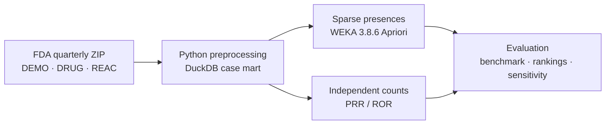
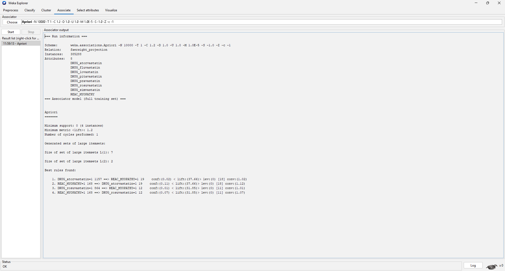
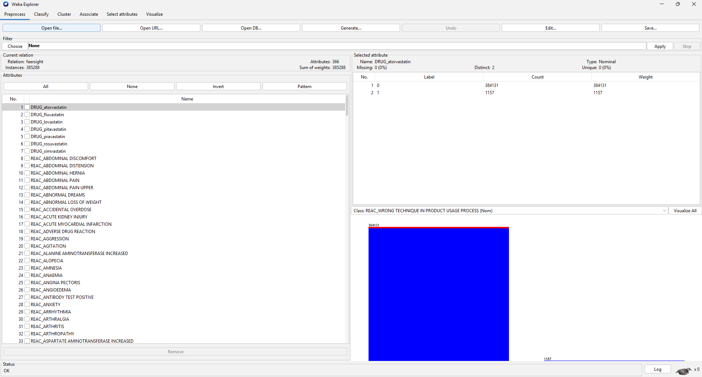
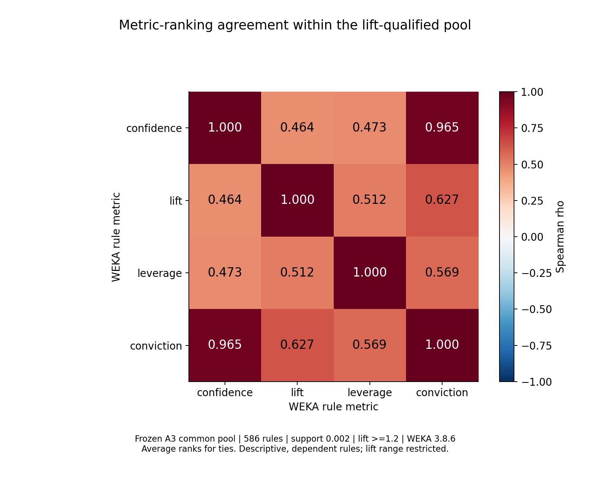

# FAERSight

*Association mining meets statistical reporting-signal analysis.*

FAERSight studies how cholesterol-lowering statins and adverse events are reported
together in the FDA Adverse Event Reporting System (FAERS). It compares rules mined
by **WEKA Apriori** with **proportional reporting ratios (PRR)** and **reporting odds
ratios (ROR)** calculated from the same case-level data. The study examines how
those findings change with mining thresholds and with the drugs reporters identify
as suspects.

**2025 Q4 · 385,288 reports · 7 statins · 359 reaction terms**

[Key results](#key-results) · [Approach](#approach) · [Run the project](#run-the-project) · [Limitations](#limitations)

## Why this problem?

Safety reports are useful leads, but difficult analytical inputs: a case can have
follow-up versions, several drugs with different suspect roles, inconsistent
product names and repeated reactions. Rare co-reports can also produce large
ratios. A ranking is therefore only interpretable alongside its preprocessing
choices, background population and underlying counts.

Association rules describe co-reporting patterns through support, confidence and
lift. PRR and ROR compare reporting proportions or odds against other reports.
Putting them on the **same reporting universe** makes their agreement—and the
effects of analysis choices—auditable.

> **Research question:** How do WEKA Apriori drug → reaction rules compare with
> PRR/ROR rankings, and how do support thresholds and primary versus secondary
> suspect-drug definitions change the findings?

## Key results

The primary analysis uses drugs marked **primary suspect (PS)** and retains every
eligible report in the reporting universe, including reports without statins.
Independent contingency tables cover **2,513 drug–reaction pairs**. The results
below are reporting associations; they are not estimates of clinical risk.

### Support thresholds change what is recovered

| Requested support | Native count cutoff | Accepted PS rules | Benchmark recovery |
| --- | ---: | ---: | ---: |
| 0.00001 | 4 | **383** | **5 / 8** |
| 0.00005 | 19 | **61** | **4 / 8** |
| 0.00010 | 39 | **20** | **2 / 8** |

All runs use a lift floor of **1.2**. Co-report count cutoffs are WEKA's native
recorded integer cutoffs. Raising support removes sparse associations and also
loses prespecified reference pairs: fewer rules does not automatically mean better recovery.
The positive-only benchmark measures recovery within this experiment; it cannot
estimate specificity or overall detection accuracy.

Sources: [run settings/counts](artifacts/manifests/2025Q4-statins-mining/weka_runs.csv),
[scored rules](artifacts/manifests/2025Q4-statins-mining/accepted_rules_scored.csv),
[all benchmark outcomes, including misses](artifacts/manifests/2025Q4-statins-mining/benchmark_recovery.csv).

### Concrete drug–reaction examples

- **Atorvastatin → myopathy:** 19 co-reports among 1,157 atorvastatin-PS reports;
  reporting confidence **1.64%**, lift **37.66**, PRR **42.34**, ROR **43.03**.
  A large enrichment ratio can coexist with a small absolute count.
- **Rosuvastatin → rhabdomyolysis:** 127 co-reports; lift **68.98**, PRR **81.42**,
  ROR **95.28**. This reference pair is recovered at every tested support level.
- **Simvastatin → myopathy:** lift **24.40**, but only **2 co-reports**, below all
  tested support cutoffs. A high ratio alone does not make a pair eligible.

These are examples from the [frozen positive benchmark](benchmarks/known_signals.yaml).
Scores are rounded here; exact counts and values are retained in the
[benchmark results](artifacts/manifests/2025Q4-statins-mining/benchmark_recovery.csv).

### Rankings agree closely; suspect roles change the leaders

At the lowest support, lift versus PRR has Spearman **ρ = 0.99997**, and lift
versus ROR **ρ = 0.99989**, on **382 shared finite, accepted pairs**. Each comparison
shares **9 of its top 10** pairs. These related scores use the same contingency
counts, so their strong agreement is not independent clinical validation.
[Ranking evidence and tie policies →](artifacts/manifests/2025Q4-statins-mining/ranking_comparison.json)

Adding **secondary suspect (SS)** drugs changes statin-exposed reports from
**2,298 to 3,703** within the same population. At the lowest support, accepted rules
change from **383 to 763**: **371 shared, 392 gained and 12 lost**. The larger rule
set still recovers [5 / 8 benchmark pairs](artifacts/manifests/2025Q4-statins-sensitivity/benchmark_recovery.csv).
PS versus PS+SS lift rankings have **ρ = 0.7931** and only **4 / 10** top-pair overlap on their
**2,154 shared finite candidate pairs**—a different pool from the comparison above.

For example, rosuvastatin–rhabdomyolysis co-reports increase **127 → 149**, while
lift decreases **68.98 → 46.37**. Broadening exposure adds reports to the drug's
denominator as well as its joint count; it does not uniformly strengthen scores.
The sensitivity retains the primary reaction vocabulary and includes a separately
reviewed exact SS ingredient overlay.
[Sensitivity evidence →](artifacts/manifests/2025Q4-statins-sensitivity/role_comparison.json)
[Count-level examples →](artifacts/manifests/2025Q4-statins-sensitivity/all_counts_screened.csv)

## Approach



Python streams the source tables, selects the latest report **within the frozen
quarter**, checks eligibility and applies reviewed exact ingredient/brand mappings.
DuckDB preserves source-row provenance and supports analytical summaries. Each
Apriori search keeps all reports and all statin columns while selecting one
reaction; drug and reaction presences remain separate items. **WEKA executes
Apriori; Python independently checks counts and scores.**

### The primary experiment in WEKA Explorer



*The all-report MYOPATHY projection has 385,288 instances and eight attributes.
Explorer displays four general rules, including reverse directions; the scientific
export retains the two statin → reaction rules. Displayed confidence is rounded.*
[Exact settings, source values and screenshot verification →](docs/weka_explorer_demo.md)

<details>
<summary>Inspect the full dataset in Explorer</summary>



*The full ARFF contains the seven statins and 359 reaction terms. Reports without
a selected item remain part of the reporting denominator.*

</details>

## Secondary study: unrestricted Apriori and FPGrowth

This separate tool study mines all attributes together, including multi-item rules.
It examines **reaction co-reporting and algorithm/metric behavior**, separately
from the projected drug–reaction analysis above.

At support **0.002**, Apriori and FPGrowth returned the same **586 reaction-only
rules**: **Jaccard 1.0**, with exact shared-metric agreement. No statin-containing
rule was emitted at that cutoff. Confidence and conviction rank this common pool
similarly (**ρ = 0.9648**); confidence and lift agree less (**ρ = 0.4637**).



*Descriptive correlations within a support- and lift-qualified pool of dependent
rules. This chart is not the primary lift-versus-PRR/ROR comparison.*

[Algorithm comparison](docs/weka_showcase_fallback_a3.md) ·
[Metric study and pool restrictions](docs/weka_showcase_metrics.md) ·
[Preserved lower-support Apriori timeout](docs/history/weka_showcase_step2b.md)

## Run the project

**Stack:** Python 3.11+ for preprocessing/statistics, DuckDB/SQL for the mart,
Java 21 and WEKA 3.8.6 for mining, and uv, pytest, Ruff and GitHub Actions for
reproducibility and checks. No Python Apriori substitute is used.

### Quick start: synthetic end-to-end verification

From the repository root, with uv and Java 21 available:

```bash
uv sync --frozen --extra dev
bash scripts/setup_weka.sh
export WEKA_JAR="$PWD/.tools/weka/weka-stable-3.8.6.jar"
uv run --frozen faersight reproduce-fixture --jar "$WEKA_JAR" \
  --output artifacts/generated/readme-fixture
```

This runs a controlled fixture through preprocessing, ARFF export, actual WEKA
and independent score comparison. It does not reproduce the real-data findings.

<details>
<summary>Windows PowerShell</summary>

```powershell
uv sync --frozen --extra dev --cache-dir .tools/uv-cache
powershell -ExecutionPolicy Bypass -File scripts/setup_weka.ps1
$env:WEKA_JAR = (Resolve-Path '.tools/weka/weka-stable-3.8.6.jar').Path
.venv/Scripts/python -m faersight.cli reproduce-fixture --jar $env:WEKA_JAR --output artifacts/generated/readme-fixture
```

Java resolution checks `JAVA_HOME`, `PATH`, then Android Studio's Windows runtime;
use `--java` to select an executable explicitly.

</details>

<details>
<summary>Reproduce the frozen FDA workflow</summary>

Run after setup, using **new output directories**. Acquisition verifies the pinned
FDA archive. Raw files, DuckDB databases and case-level JSON/CSV outputs remain local.

```bash
uv run --frozen faersight validate-config config/experiment.yaml --require-frozen
uv run --frozen faersight acquire --config config/experiment.yaml
uv run --frozen faersight ingest --config config/experiment.yaml \
  --output data/processed/reproduction
uv run --frozen faersight mine data/processed/reproduction/analytical.duckdb \
  --jar "$WEKA_JAR" --output artifacts/generated/reproduction-primary
uv run --frozen faersight sensitivity data/processed/reproduction/analytical.duckdb \
  --primary-run artifacts/generated/reproduction-primary \
  --jar "$WEKA_JAR" --output artifacts/generated/reproduction-sensitivity
```

Existing validated snapshots cannot be overwritten. Full-data runs are separate
from the lightweight fixture checks. Follow the
[primary execution contract](docs/milestone3.md),
[sensitivity contract](docs/milestone4.md) and
[reproduction guide](docs/reproduction_and_demo_readiness.md) for resources,
provenance, failed-run handling and same-host reproduction limits.

</details>

For the full test suite, first provision the separate
[pinned plotting environment](docs/plotting_runtime.md), then run:

```bash
uv run --frozen python -m pytest -q
uv run --frozen ruff check .
```

Set `WEKA_JAR` to enable actual WEKA tests. Some showcase tests require the original
Windows runtime; environment-specific passes/skips and clean-environment evidence
are recorded in the [validation audit](docs/final_readiness_20261106.md#verification-record).

## Limitations

- **Reports are not a patient population.** Incomplete/duplicate submissions,
  reporting bias, underlying illness and co-medication complicate interpretation.
  These data do not supply clinical incidence or prove causality.
  [FDA guidance →](https://open.fda.gov/apis/drug/event/)
- **Sparse cells can dominate ratios.** Counts, zero-cell flags and uncertainty
  conventions accompany scores; PRR/ROR are comparative measures, not ground truth.
- **Scope is deliberately narrow.** One quarter, one drug class, exact mappings
  and a fixed reaction vocabulary limit generalization. Original cross-quarter
  version histories were not audited; suspect roles express reporter attribution.
- **Evaluation is bounded.** The benchmark is positive-only, ranking comparisons
  use declared matched pools, and scientific interpretation/student signoff remain
  pending. Computational agreement does not constitute clinical validation.

## Documentation and evidence

- **Data and preprocessing:** [source/integration record](docs/milestone2.md),
  [frozen experiment](config/experiment.yaml), [reviewed aliases](mappings/drug_mapping.csv).
- **Research results:** [primary analysis](docs/milestone3.md),
  [role sensitivity](docs/milestone4.md), [frozen benchmark](benchmarks/known_signals.yaml).
- **Verification:** [case-by-case source audit](docs/case_source_evidence_review_20261106.md),
  [SS ingredient-reference review](docs/rosuvastatin_zinc_reference_review_20261106.md),
  [Explorer checklist](docs/weka_explorer_verification_checklist.md).
- **Engineering detail:** [reproduction/demo guide](docs/reproduction_and_demo_readiness.md),
  [requirements and remaining gates](docs/final_readiness_20261106.md),
  [repository layout and inventory](docs/repository_layout.md),
  [project specification](PRD.md).

Course reports, slide text and narration remain student-authored; these repository
documents and generated outputs are technical evidence.
